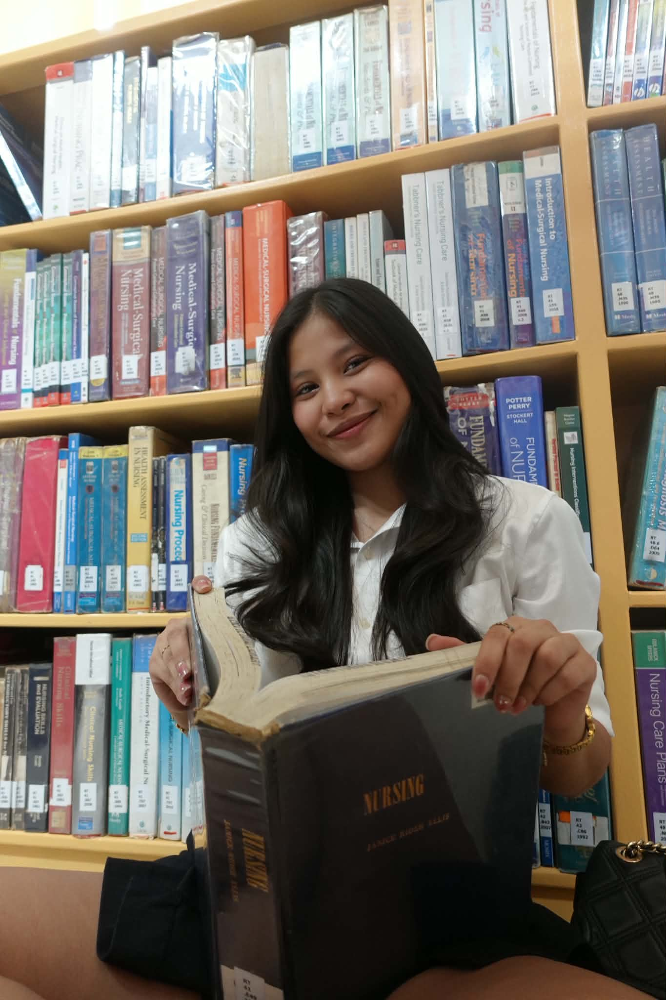

<table align="center" width="840" cellpadding="0" cellspacing="0">
  <!-- TOP COQUETTE MARGIN BORDER -->
  <tr>
    <td colspan="5" height="10" bgcolor="#F8BBD0"></td>
  </tr>
  <tr>
    <td width="10" bgcolor="#F8BBD0"></td>
    <td colspan="3" align="center" bgcolor="#FFF5F8">
       
      ⋆｡‧˚ʚ 🎀 ɞ˚‧｡⋆ ┈┈┈┈┈┈┈୨୧┈┈┈┈┈┈┈ ⋆｡‧˚ʚ 🎀 ɞ˚‧｡⋆
        
    </td>
    <td width="10" bgcolor="#F8BBD0"></td>
  </tr>

  <!-- MAIN BODY WITH LEFT & RIGHT DECORATIVE MARGINS -->
  <tr>
    <!-- OUTER LEFT RIBBON MARGIN -->
    <td width="10" bgcolor="#F8BBD0"></td>

    <!-- INNER LEFT LACE & BOW MARGIN -->
    <td width="38" align="center" valign="top" bgcolor="#FFF5F8">
       
      🎀 ┊ ♡ ┊ ୨୧ ┊ 🩰 ┊ ♡ ┊ 🎀 ┊ ୨୧ ┊ ♡ ┊ 🩰 ┊ 🎀 ┊ ♡ ┊ ୨୧ ┊ 🩰 ┊ ♡ ┊ 🎀 ┊ ୨୧ ┊ ♡ ┊ 🩰 ┊ 🎀 ┊ ♡ ┊ ୨୧ ┊ 🩰 ┊ ♡ ┊ 🎀
    </td>

    <!-- CENTER CONTENT AREA (WITH PADDED MARGINS) -->
    <td width="744" align="center" bgcolor="#FFFFFF">
      <table width="690" align="center" cellpadding="10" cellspacing="0">
        <tr>
          <td align="center">

            <!-- HEADER SECTION -->
            

            

              <b>Bachelor of Science in Nursing • 4D • 1st Semester</b> 
              <i>Ateneo de Davao University • GE 4120 – 21st Century IT Skills</i>
            

            

              
              
              
            

            
︶꒦꒷♡꒷꒦︶ 🎀 ︶꒦꒷♡꒷꒦︶

             

            <!-- STUDENT PROFILE CARD -->
            <table align="center" width="680" cellpadding="14" cellspacing="0" bgcolor="#FFF9FB">
              <tr>
                <th colspan="2" bgcolor="#F8BBD0" align="center">
                  
                </th>
              </tr>
              <tr>
                <td align="center" width="230" bgcolor="#FFF9FB">
                  
                </td>
                <td align="left" bgcolor="#FFF9FB">
                  
🎀 <b>Name:</b> Ma. Lorraine C. Narciso

                  
🩺 <b>Program:</b> Bachelor of Science in Nursing

                  
📚 <b>Year & Section:</b> 4D — 1st Semester

                  
🏫 <b>University:</b> Ateneo de Davao University

                  
💻 <b>Subject:</b> GE 4120 – 21st Century IT Skills

                  
✨ <b>Interests:</b> Cooking, Playing Instruments, Stickers, Watching Movies & Series

                </td>
              </tr>
            </table>

             

            <!-- ABOUT ME SECTION -->
            
$\color{#D81B60}{\Large\textbf{୨୧ ₊˚ 🎀 𝓐𝓫𝓸𝓾𝓽 𝓜𝓮 🎀 ˚₊ ୨୧}}$

            <table align="center" width="680" cellpadding="16" cellspacing="0" bgcolor="#FFF9FB">
              <tr>
                <th bgcolor="#F8BBD0" align="center">
                  
                </th>
              </tr>
              <tr>
                <td align="left" bgcolor="#FFF9FB">
                  
🩰 Hello and welcome to my GitHub portfolio! My name is <b>Ma. Lorraine C. Narciso</b>, and I am currently a fourth-year student pursuing a <b>Bachelor of Science in Nursing (4D, 1st Semester)</b> at <b>Ateneo de Davao University</b>. Being in my final year of nursing school has shaped my appreciation for compassionate care, patience, and attention to detail—values that guide both my clinical training and my everyday life.

                  
🎀 Alongside my nursing studies, taking <b>GE 4120 – 21st Century IT Skills</b> has shown me how digital tools and thoughtful design can support modern healthcare advocacy. From designing branding kits and event posters to building AI-powered health websites and organized budget sheets, I enjoy blending clean aesthetics with purposeful communication.

                  
🍳 Outside of hospital duties and academic deadlines, I love unwinding through cozy, hands-on hobbies. You can often find me trying out new recipes in the kitchen while <b>cooking</b>, relaxing with music by <b>playing instruments</b>, or collecting cute <b>stickers</b> to decorate my journals, study notes, and personal planners.

                  
🎬 When it is time to recharge, nothing beats curling up for a relaxing marathon of <b>watching movies and series</b>. Whether I am diving into heartwarming dramas, lighthearted comedies, or gripping mysteries, good stories spark my imagination and keep me balanced through busy weeks.

                </td>
              </tr>
            </table>

             

            <!-- SKILLS & TOOLS SECTION -->
            
$\color{#D81B60}{\Large\textbf{୨୧ ₊˚ 🎀 𝓢𝓴𝓲𝓵𝓵𝓼 & 𝓣𝓸𝓸𝓵𝓼 𝓛𝓮𝓪𝓻𝓷𝓮𝓭 🎀 ˚₊ ୨୧}}$

            <table align="center" width="680" cellpadding="12" cellspacing="0" bgcolor="#FFF9FB">
              <tr>
                <th colspan="4" bgcolor="#F8BBD0" align="center">
                  
                </th>
              </tr>
              <tr>
                <td align="center" width="170" bgcolor="#FFF9FB">
                   
                  <b>Canva Design</b> 
                  Posters, logos, branding kits & layouts
                </td>
                <td align="center" width="170" bgcolor="#FFF9FB">
                   
                  <b>Google Docs</b> 
                  Real-time collaboration & cloud editing
                </td>
                <td align="center" width="170" bgcolor="#FFF9FB">
                   
                  <b>MS Word</b> 
                  Structured proposals & formal documents
                </td>
                <td align="center" width="170" bgcolor="#FFF9FB">
                   
                  <b>MS Excel</b> 
                  Event budgeting & automated formulas
                </td>
              </tr>
              <tr>
                <td align="center" width="170" bgcolor="#FFF9FB">
                   
                  <b>ChatGPT</b> 
                  Prompt engineering & text drafting
                </td>
                <td align="center" width="170" bgcolor="#FFF9FB">
                   
                  <b>Gemini AI</b> 
                  Formatted resumes & comparative outputs
                </td>
                <td align="center" width="170" bgcolor="#FFF9FB">
                   
                  <b>AI Web & Art</b> 
                  Advocacy websites & digital paintings
                </td>
                <td align="center" width="170" bgcolor="#FFF9FB">
                   
                  <b>GitHub & MD</b> 
                  Repository portfolios & README styling
                </td>
              </tr>
            </table>

             

            <!-- ACTIVITIES & MIDTERM EXAM SECTION -->
            
$\color{#D81B60}{\Large\textbf{୨୧ ₊˚ 🎀 𝓒𝓸𝓾𝓻𝓼𝓮 𝓐𝓬𝓽𝓲𝓿𝓲𝓽𝓲𝓮𝓼 & 𝓜𝓲𝓭𝓽𝓮𝓻𝓶 𝓔𝔁𝓪𝓶 🎀 ˚₊ ୨୧}}$

            <table align="center" width="680" cellpadding="12" cellspacing="0" bgcolor="#FFF9FB">
              <tr>
                <th width="210" bgcolor="#F8BBD0" align="center">$\color{#D81B60}{\textbf{Output}}$</th>
                <th width="470" bgcolor="#F8BBD0" align="center">$\color{#D81B60}{\textbf{Brief Overview}}$</th>
              </tr>
              <tr>
                <td align="center" bgcolor="#FFF9FB"><b>🎀 Activity 1</b> Event Poster Design</td>
                <td align="left" bgcolor="#FFF9FB">Designed an official promotional poster for the Ateneo de Davao University School of Nursing's free coffee giveaway at Arrupe Hall, Booth 7.</td>
              </tr>
              <tr>
                <td align="center" bgcolor="#FFF9FB"><b>🩰 Activity 2</b> Personal Branding Kit</td>
                <td align="left" bgcolor="#FFF9FB">Created a cohesive branding archive featuring a custom logo, personal tagline, color palette and typography guide, and matching resume header.</td>
              </tr>
              <tr>
                <td align="center" bgcolor="#FFF9FB"><b>🎀 Activity 4</b> Google Workspace Guide</td>
                <td align="left" bgcolor="#FFF9FB">Collaborated with Group 5 to present how to use Google Docs and hosted an interactive "Live Google Docs Race" highlighting real-time teamwork.</td>
              </tr>
              <tr>
                <td align="center" bgcolor="#FFF9FB"><b>🩰 Activity 5</b> AI Image Generation</td>
                <td align="left" bgcolor="#FFF9FB">Generated two digital paintings using AI text prompts and evaluated their visual clarity, artistic detail, and prompt accuracy.</td>
              </tr>
              <tr>
                <td align="center" bgcolor="#FFF9FB"><b>🎀 Activity 6</b> CARE FIRST Website</td>
                <td align="left" bgcolor="#FFF9FB">Built a responsive nursing advocacy website educating mothers and families on safe pregnancy, newborn care, and WHO/DOH danger signs.</td>
              </tr>
              <tr>
                <td align="center" bgcolor="#FFF9FB"><b>🩰 Activity 7</b> Resume Generation</td>
                <td align="left" bgcolor="#FFF9FB">Compared ChatGPT and Gemini in generating a one-page nursing resume to evaluate formatting, visual hierarchy, and layout quality.</td>
              </tr>
              <tr>
                <td align="center" bgcolor="#FCE4EC"><b>👑 Midterm Exam</b> Proposal & Budget</td>
                <td align="left" bgcolor="#FCE4EC">Combined a formal Word event proposal and an Excel budget sheet for the <i>Nursing Leadership and Management Event</i> (80 participants, ₱14,075 total budget).</td>
              </tr>
            </table>

             

            <!-- CUTE QUOTE FOOTER -->
            

              $\color{#D81B60}{\textbf{“Healing hands, a creative mind, and a heart full of grace.”}}$ 
              <i>₊˚⊹ ♡ made with love by Lorraine ♡ ⊹˚₊</i>
            

          </td>
        </tr>
      </table>
    </td>

    <!-- INNER RIGHT LACE & BOW MARGIN -->
    <td width="38" align="center" valign="top" bgcolor="#FFF5F8">
       
      🎀 ┊ ♡ ┊ ୨୧ ┊ 🩰 ┊ ♡ ┊ 🎀 ┊ ୨୧ ┊ ♡ ┊ 🩰 ┊ 🎀 ┊ ♡ ┊ ୨୧ ┊ 🩰 ┊ ♡ ┊ 🎀 ┊ ୨୧ ┊ ♡ ┊ 🩰 ┊ 🎀 ┊ ♡ ┊ ୨୧ ┊ 🩰 ┊ ♡ ┊ 🎀
    </td>

    <!-- OUTER RIGHT RIBBON MARGIN -->
    <td width="10" bgcolor="#F8BBD0"></td>
  </tr>

  <!-- BOTTOM COQUETTE MARGIN BORDER -->
  <tr>
    <td width="10" bgcolor="#F8BBD0"></td>
    <td colspan="3" align="center" bgcolor="#FFF5F8">
       
      ︶꒦꒷♡꒷꒦︶ ┈┈┈┈┈┈┈🎀┈┈┈┈┈┈┈ ︶꒦꒷♡꒷꒦︶
        
    </td>
    <td width="10" bgcolor="#F8BBD0"></td>
  </tr>
  <tr>
    <td colspan="5" height="10" bgcolor="#F8BBD0"></td>
  </tr>
</table>
